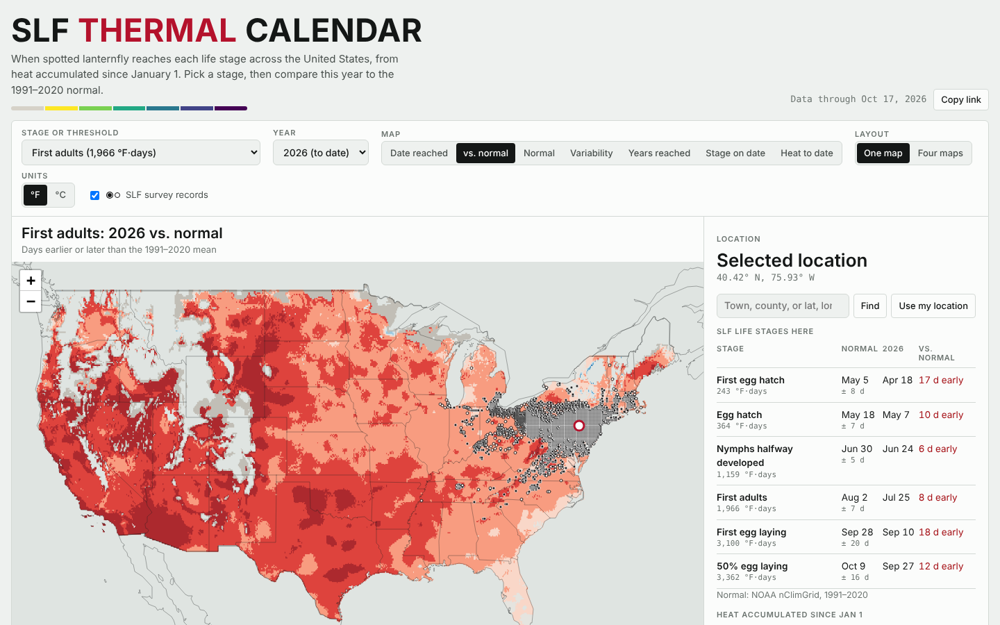

# SLF Thermal Calendar

**Live app: https://harrisonmiles13.github.io/slf-thermal-calendar/**

When does spotted lanternfly (*Lycorma delicatula*, SLF) reach each life stage
across its North American range? This app maps the date that accumulated heat
crosses each SLF degree-day threshold, for any year since 2016 and for the
1991–2020 normal. The idea follows the USA National Phenology Network
[Thermal Calendars](https://www.usanpn.org/data/maps/thermal_calendars), refocused
on SLF and extended to the contiguous US.



## What it shows

For a chosen SLF stage (or a plain degree-day threshold, 100–3,600 °F·days,
base 50 °F) and year:

| Map | Meaning |
|---|---|
| Date reached | Day the threshold was passed that year (hatched = not yet) |
| vs. normal | Days earlier or later than the 1991–2020 mean |
| Normal | 1991–2020 mean date (where reached in at least half the years) |
| Variability | Standard deviation of that date, 1991–2020 |
| Years reached | Share of 1991–2020 years the threshold was reached by Dec 31 |
| Stage on date | Most advanced SLF stage on any day, with a season animation |
| Heat to date | °F·days (or °C·days) accumulated since Jan 1 |

"Four maps" shows the first four together, like the NPN product. Clicking a
location gives the six stage dates (normal ± SD, chosen year, difference) and
a heat-accumulation chart. For the current year the panel also pulls observed
weather and a 16-day forecast from [Open-Meteo](https://open-meteo.com/) and
projects remaining stages assuming normal temperatures. Locations outside the
grid (southern Canada, Mexico) get their season and 1991–2020 normal from
Open-Meteo's ERA5 archive. SLF survey records from
[lydemapr](https://github.com/ieco-lab/lydemapr) can be overlaid.

## Model

DDRP spotted lanternfly model (Barker, Beyer & Coop 2025,
[Insects 16:790](https://doi.org/10.3390/insects16080790); parameter file
`SLF.params` in [bbarker505/ddrp_v3](https://github.com/bbarker505/ddrp_v3)):
lower threshold 10 °C, upper 35 °C with horizontal cutoff, single-triangle
method, accumulation from January 1.

| Event | °C·days | °F·days |
|---|---:|---:|
| First egg hatch (earliest cohort) | 135 | 243 |
| Egg hatch | 202 | 364 |
| Nymphs halfway developed | 644 | 1,159 |
| First adults | 1,092 | 1,966 |
| First egg laying | 1,722 | 3,100 |
| 50% egg laying | 1,868 | 3,362 |

## Data pipeline

Daily temperatures come from NOAA
[nClimGrid-Daily](https://registry.opendata.aws/noaa-nclimgrid/) (contiguous
US, 1/24°), read from NOAA's public AWS bucket and averaged to 1/12° (~8 km).

```bash
pip install -r pipeline/requirements.txt
python pipeline/build_grids.py 1991-2026 --jobs 3 --normals  # ~30 min, ~20 GB streamed
python pipeline/build_static.py                              # boundaries + SLF records
python pipeline/build_site.py --normals --years 2016-2026   # web files + point tiles
python pipeline/assemble_page.py                             # site/index.html
python tests/test_model.py                                   # model + data checks
python -m http.server -d site 8000                           # http://localhost:8000
```

| File | Role |
|---|---|
| `pipeline/slf_model.py`, `site/js/model.js` | The degree-day model (Python and JS, tested against each other) |
| `pipeline/build_grids.py` | nClimGrid → per-year threshold dates, 1991–2020 normals |
| `pipeline/build_site.py` | Packs grids as gzipped uint16 layers + 32×32 point tiles |
| `pipeline/build_static.py` | State/country lines, lydemapr SLF records |
| `site/index.src.html`, `site/js/app.js` | The app (Leaflet, no build step) |
| `.github/workflows/update.yml` | Daily refresh and deploy |

The 1991–2020 normals and finished years are committed under
`site/data/grid/`. The **Update maps** workflow runs daily: it recomputes the
current and previous year from nClimGrid (preliminary grids lag about two
days), rebuilds the point tiles, publishes `site/` to the `gh-pages` branch, and
commits a year to `main` once all twelve of its monthly grids are final.

## Limits

* Gridded maps cover the contiguous US only; elsewhere the point panel uses
  Open-Meteo (ERA5), which can differ from nClimGrid by a few days.
* 8 km cells average terrain and microclimate. Treat dates as a scouting aid
  and confirm stages in the field.
* The model predicts timing, not presence. SLF records (lydemapr, through
  2025) show where SLF has been found; absence of a record is not absence.

## Sources

* Barker, B.S., Beyer, J. & Coop, L. (2025). Real-time integrative mapping of the phenology and climatic suitability for the spotted lanternfly, *Lycorma delicatula*. *Insects* 16: 790.
* Durre, I. et al. (2022). NOAA's nClimGrid-Daily version 1. NOAA NCEI.
* De Bona, S. et al. (2023). lydemapr: an R package to track the spread of the invasive spotted lanternfly. *NeoBiota* 86: 151–168. Data CC BY 4.0.
* USA National Phenology Network, Thermal Calendars (concept). This project is not affiliated with USA-NPN, NOAA or USDA.
